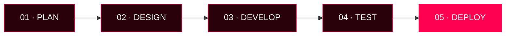

 <div align="center">


<br/>

<a href="https://masfiqul.me"></a>
<a href="https://www.linkedin.com/in/masfiqulislamrasib/"></a>
<a href="mailto:im.masfiqul@gmail.com"></a>
<a href="https://github.com/Masfiqul01"></a>


</div>

---

## 👨‍💻 ABOUT ME

Hey! I'm **Masfiqul Islam Rasib**, a Full-Stack Web Developer and Designer from Khulna, Bangladesh.

I specialize in building modern, responsive, and scalable web applications, SaaS platforms, and business automation solutions.

- 💻 Developing modern websites and web applications.
- 🚀 Building SaaS products and business automation systems.
- 🎨 Creating clean, responsive UI/UX experiences.
- ⚡ Working with WordPress, React, Next.js, and Node.js.
- 🔍 Focused on SEO, AEO, GEO, and web performance.
- 🤖 Exploring AI-powered applications and automation.

```javascript
const masfiqul = {
  name: "Masfiqul Islam Rasib",
  role: ["Full-Stack Developer", "Web Designer", "SaaS Developer"],
  location: "Khulna, Bangladesh",
  website: "https://masfiqul.me",
  interests: [
    "Web Development",
    "SaaS Development",
    "AI Automation",
    "UI/UX Design",
    "SEO"
  ],
  currentlyBuilding: "Modern Web & SaaS Solutions",
  mindset: "Build. Learn. Improve. Repeat."
};
```

---

## 🚀 WHAT I DO

<table>
<tr>
<td width="50%" valign="top">

### 🌐 Web Development

- WordPress Development
- WooCommerce Solutions
- React & Next.js Applications
- Node.js Backend Development
- Custom API Integration
- Responsive Web Design

</td>
<td width="50%" valign="top">

### ⚡ SaaS & Automation

- SaaS Platform Development
- AI Chatbot Integration
- Business Workflow Automation
- Omnichannel Messaging Systems
- Authentication & Database
- API & Third-Party Integrations

</td>
</tr>
<tr>
<td width="50%" valign="top">

### 🎨 Design & Experience

- UI/UX Design
- Figma to Website
- Landing Page Design
- Admin Dashboard Design
- Conversion-Focused Interfaces

</td>
<td width="50%" valign="top">

### 🔍 SEO & Optimization

- Technical SEO
- On-Page SEO
- Local SEO
- AEO & GEO
- Website Performance
- Search Visibility

</td>
</tr>
</table>

---

## 🏗️ FEATURED PROJECTS

### 🔴 OrmiTech IT

**SaaS Platform | Business Messaging & Automation**

A business automation platform focused on AI-powered customer communication and omnichannel messaging.

- AI Chatbot & Automated Replies
- Facebook, Instagram, WhatsApp & Website Chat
- Shared Inbox & Conversation Management
- Lead and Customer Communication
- Business Workflow Automation

**Tech Stack:** Next.js, React, Tailwind CSS, Node.js, Supabase, Firebase, Meta API

🌐 [Visit OrmiTech IT](https://ormitechit.com)

### 🌐 Trixtint

**WordPress Website Development**

A responsive business website built with WordPress and Elementor.

**Tech Stack:** WordPress, Elementor, Responsive Web Design

🌐 [Visit Trixtint](https://trixtint.com)

### 💜 Safe Women Care

**WordPress Website Development**

A responsive website developed using WordPress and Elementor.

**Tech Stack:** WordPress, Elementor, UI Design

🌐 [Visit Safe Women Care](https://safewomencare.com)

---

## 🧩 MY DEVELOPMENT STACK

<p align="center">
  
</p>

<p align="center">
  <b>FRONTEND</b><br/><br/>
  
</p>

<p align="center">
  <b>BACKEND & DATABASE</b><br/><br/>
  
</p>

<p align="center">
  <b>CMS, TOOLS & DESIGN</b><br/><br/>
  
</p>

<p align="center">
  
  
  
</p>

---

## 📊 GITHUB ANALYTICS

<p align="center">
  
  
</p>

<p align="center">
  
</p>

<p align="center">
  
</p>

<p align="center">
  
</p>

---

## 🐍 CONTRIBUTION MATRIX

<p align="center">
  
</p>

<p align="center">
  
  <i>Every contribution is a step forward. Keep building. Keep creating.</i>
</p>

---

## ⚙️ DEVELOPMENT WORKFLOW

<p align="center">
  
</p>



<p align="center">
  
  
  
  
  
</p>

---

## 🤝 CONNECT WITH ME

<p align="center">
  <a href="https://masfiqul.me">
    
  </a>
  <a href="https://www.linkedin.com/in/masfiqulislamrasib/">
    
  </a>
  <a href="https://www.facebook.com/masfiqulislamrasib/">
    
  </a>
  <a href="mailto:im.masfiqul@gmail.com">
    
  </a>
</p>

<p align="center">
  <b>💡 Have an idea? Let's build something meaningful together.</b>
</p>

<div align="center">
  
  
  <b>© Masfiqul Islam Rasib | Built with passion & code.</b>
</div>
