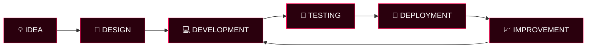

 

<!-- ANIMATED HEADER -->

 

---

## 👨‍💻 WHO AM I?

Hi! I'm **Masfiqul Islam Rasib**, a Full-Stack Web Developer and Designer from Khulna, Bangladesh.

I build modern, responsive, and scalable digital experiences — from business websites and eCommerce platforms to SaaS applications and automation systems.

- 🌐 Portfolio: [masfiqul.me](https://masfiqul.me)
- 🚀 Founder of [OrmiTech IT](https://ormitechit.com)
- 💻 Focused on Full-Stack Development and SaaS Products
- 🎨 Interested in UI/UX, modern web design, and digital experiences
- 🤖 Exploring AI-powered applications and business automation
- 📍 Khulna, Bangladesh

---

## 🚀 WHAT I BUILD

- **Business Websites:** Professional, responsive websites for businesses and brands.
- **eCommerce Platforms:** WooCommerce stores and custom eCommerce solutions.
- **SaaS Applications:** Scalable web applications with authentication, dashboards, and APIs.
- **Custom Web Applications:** Full-stack applications built around real business requirements.
- **AI & Automation:** Chatbots, messaging automation, and intelligent workflows.
- **SEO-Friendly Websites:** Technical SEO, on-page optimization, and search visibility.

---

## 🌌 TECHNOLOGY UNIVERSE

### 🎨 FRONTEND & DESIGN

### ⚙️ BACKEND & FRAMEWORKS

### 🗄️ DATABASE & AUTHENTICATION

### 🛠️ TOOLS & DEPLOYMENT

### 💡 CORE DEVELOPMENT SKILLS

---

## 🧠 AI & AUTOMATION

I'm interested in building intelligent systems that help businesses work smarter.

- AI Chatbot Development
- Facebook and Instagram Messaging Automation
- WhatsApp Business API Integration
- Omnichannel Communication Systems
- AI-Powered Customer Support
- Workflow and Business Process Automation
- API Integrations and Custom AI Applications

---

## 🚀 ORMITECH IT — FEATURED PROJECT

**OrmiTech IT** is a technology initiative focused on business messaging automation and digital solutions.

**Areas of development:**
- Omnichannel shared inbox
- AI chatbot and automated replies
- WhatsApp, Messenger, and Instagram integrations
- Lead and conversation management
- Customer support workflows

**Technologies:** Next.js, React, Tailwind CSS, Node.js, Supabase, Firebase Auth, Meta APIs.

🌐 Website: [ormitechit.com](https://ormitechit.com)

---

## 🧩 MY DEVELOPMENT STACK

**Frontend**

**Backend & Database**

**CMS & eCommerce**

---

## 📊 GITHUB ANALYTICS

---

## 🐍 CONTRIBUTION MATRIX

---

## 🔄 DEVELOPMENT WORKFLOW

---

## 🔨 CURRENTLY BUILDING

- Improving full-stack development skills.
- Building SaaS products and business automation systems.
- Exploring AI integrations and intelligent workflows.
- Learning and experimenting with modern web technologies.

---

## 💭 WHAT I BELIEVE

> Great software is not just about writing code. It's about solving real problems, creating meaningful experiences, and continuously improving.

---

## 🤝 OPEN TO COLLABORATION

### HAVE AN IDEA? LET'S MAKE IT HAPPEN.

  

  

---

## ☕ SUPPORT MY WORK

If you like my work and want to support my journey, consider giving a ⭐ to my repositories.

  

### 🌐 CONNECT WITH ME

  

**© 2026 Masfiqul Islam Rasib — Building the web, one commit at a time.**

