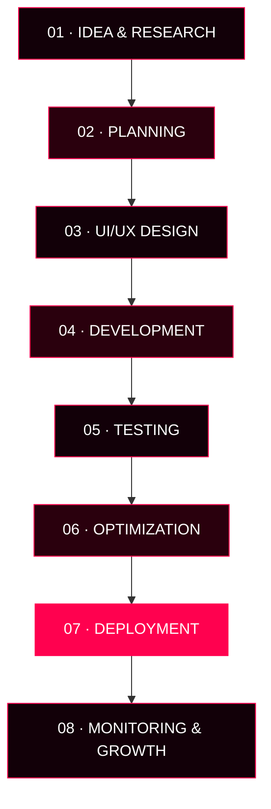

 <div align="center">

<!-- ANIMATED HEADER -->


<br/>


<br/>


<br/><br/>

<!-- SOCIAL BUTTONS -->

<a href="https://masfiqul.me">

</a>
<a href="https://www.linkedin.com/in/masfiqulislamrasib/">

</a>
<a href="https://github.com/Masfiqul01">

</a>
<a href="mailto:im.masfiqul@gmail.com">

</a>

<br/><br/>


&nbsp;

&nbsp;


</div>

<br/>

---

<div align="center">

# ⚡ `WHO AM I?`


</div>

<br/>

<table align="center">
<tr>
<td width="50%" valign="top">

```javascript
const masfiqul = {
  name: "Masfiqul Islam Rasib",
  location: "Khulna, Bangladesh",
  role: "Full-Stack Web Developer",

  experience: [
    "Web Development",
    "SaaS Development",
    "AI Automation",
    "Web Design",
    "SEO"
  ],

  frontend: [
    "React",
    "Next.js",
    "TypeScript",
    "Tailwind CSS"
  ],

  backend: [
    "Node.js",
    "Express.js",
    "REST APIs"
  ],

  cms: [
    "WordPress",
    "WooCommerce",
    "Elementor"
  ],

  databases: [
    "MySQL",
    "MongoDB",
    "Supabase",
    "Firebase"
  ],

  currentlyBuilding:
    "SaaS & AI Automation Systems",

  website: "https://masfiqul.me"
};
```

</td>

<td width="50%" valign="top">


<br/>

### 🧠 My Approach

```text
IDEA
 ↓
RESEARCH
 ↓
DESIGN
 ↓
DEVELOPMENT
 ↓
TESTING
 ↓
OPTIMIZATION
 ↓
DEPLOYMENT
 ↓
GROWTH
```

<br/>

> **I don't just build websites.**
>
> I build digital products that are designed to perform, scale and grow.

</td>
</tr>
</table>

---

<div align="center">

# 🚀 WHAT I BUILD

<br/>


</div>

<br/>

<div align="center">

| 🌐 Web | 🚀 SaaS | 🤖 AI | 🎨 Design | 🔎 SEO |
|---|---|---|---|---|
| Websites | Platforms | Chatbots | UI/UX | Technical |
| E-Commerce | Dashboards | Automation | Figma | On-Page |
| WordPress | APIs | LLM Apps | Responsive | Local |
| Next.js | Auth | Workflows | Landing Pages | AEO / GEO |

</div>

---

<div align="center">

# 🛠️ TECHNOLOGY UNIVERSE

<br/>


<br/><br/>


<br/><br/>

### ⚡ LANGUAGES


<br/>


<br/><br/>

### ⚛️ FRONTEND DEVELOPMENT


<br/>


<br/><br/>

### ⚙️ BACKEND & DATABASE


<br/>


<br/><br/>

### 🌐 CMS & E-COMMERCE


<br/>


<br/><br/>

### ☁️ TOOLS & DEPLOYMENT


<br/>


<br/><br/>


<br/>


</div>

<br/>

---

<div align="center">

# 💻 MY DEVELOPMENT STACK


<br/><br/>

### ⚡ FRONTEND DEVELOPMENT


<br/>


<br/><br/>

### ⚙️ BACKEND & API DEVELOPMENT


<br/>


<br/><br/>

### 🗄️ DATABASE & CLOUD


<br/>


<br/><br/>

### 🌐 CMS & E-COMMERCE


<br/>


<br/><br/>

### 🎨 DESIGN, TOOLS & DEPLOYMENT


<br/><br/>


<br/><br/>


</div>

---

<div align="center">

# 🤖 AI & AUTOMATION


<br/><br/>


</div>

---

# 🌐 Featured Project

<div align="center">

## 🔴 OrmiTech IT


<br/><br/>

**AI-powered business automation platform**

<br/>

`AI Chatbot` • `WhatsApp` • `Messenger` • `Instagram` • `Website Chat`

<br/><br/>

<a href="https://ormitechit.com">

</a>

</div>

---

<div align="center">

# 📊 GITHUB ANALYTICS


<br/><br/>


<br/><br/>


<br/><br/>


<br/><br/>


<br/><br/>


</div>

---

<div align="center">

# 📈 CONTRIBUTION MATRIX

<br/>


<br/><br/>


<br/><br/>

### 🐍 CONTRIBUTION SNAKE


<br/><br/>

### 📅 CONTRIBUTION ACTIVITY


<br/><br/>


<br/><br/>


<br/><br/>


</div>

---

# 🧩 DEVELOPMENT WORKFLOW

<div align="center">


<br/><br/>


</div>



<div align="center">

<br/>


**IDEA → DESIGN → CODE → TEST → DEPLOY → GROW**

</div>

---

<div align="center">

# 🎯 CURRENTLY BUILDING

<br/>


<br/><br/>

<table>
<tr>
<td align="center" width="33%">

### ⚡ BUILD

SaaS Products

<br/>

Scalable Web Apps

</td>

<td align="center" width="33%">

### 🤖 AUTOMATE

AI Systems

<br/>

Business Workflows

</td>

<td align="center" width="33%">

### 🚀 GROW

SEO

<br/>

AEO • GEO

</td>
</tr>
</table>

</div>

---

# 💡 WHAT I BELIEVE

<div align="center">


<br/><br/>

> **Design × Engineering × Performance × Experience**

</div>

---

# 🌎 OPEN TO COLLABORATION

<div align="center">


<br/><br/>


<br/><br/>

### 🤝 WHAT I'M OPEN TO

<br/>


<br/>


<br/><br/>


<br/><br/>

<a href="mailto:im.masfiqul@gmail.com">

</a>
<a href="https://masfiqul.me">

</a>
<a href="https://www.linkedin.com/in/masfiqulislamrasib/">

</a>

<br/><br/>


<br/>

**GOOD IDEAS BECOME GREAT PRODUCTS WHEN WE BUILD THEM TOGETHER.**

</div>

---

# ⭐ SUPPORT MY WORK

<div align="center">

<br/>


<br/><br/>


<br/><br/>

### `BUILD • SHIP • IMPROVE • REPEAT`

<br/>


</div>
